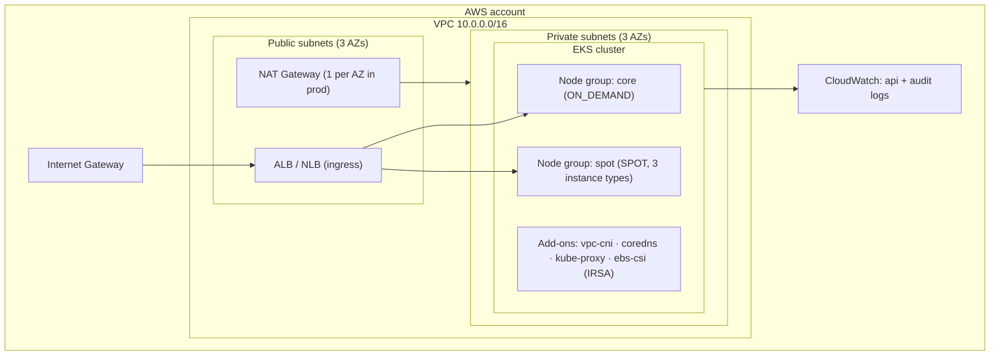

# terraform-aws-eks-blueprint

[](https://github.com/shahbazkareem/terraform-aws-eks-blueprint/actions/workflows/ci.yml)


A production-style, modular Terraform blueprint for Amazon EKS: multi-AZ networking,
IRSA-based least privilege, on-demand + spot node groups, and CI-governed code.

This is a **reference implementation** — the pattern I use to bootstrap client platforms
(banking / fintech / SaaS), stripped of anything client-specific.

## Architecture



Full design notes: [`docs/architecture.md`](docs/architecture.md)

## What this blueprint demonstrates

| Concern | Approach |
|---|---|
| Networking | 3-AZ VPC, public/private split, subnet tags wired for ALB auto-discovery |
| Cost control | Spot node group (3 instance types for better interruption odds); single NAT outside prod |
| Security | IRSA for add-on AWS permissions (no instance profiles), API/audit logging, CIDR-restricted API endpoint option |
| Operability | `configure_kubectl` output, update_config with max_unavailable, additive add-on management |
| Supply chain | CI runs `terraform fmt -check`, `validate`, and `tfsec` on every PR |

## Quick start

```bash
# 0. Prereqs: Terraform >= 1.6, AWS CLI v2 configured, kubectl
cp terraform.tfvars.example terraform.tfvars   # adjust values

# 1. Plan
terraform init
terraform plan

# 2. Apply (~15 min for the control plane)
terraform apply

# 3. Connect
aws eks update-kubeconfig --region eu-central-1 --name eks-blueprint-dev
kubectl get nodes -L workload
```

## Layout

```
├── main.tf                  # root module: composes network + eks
├── variables.tf             # inputs (node groups, CIDRs, AZ count)
├── outputs.tf               # cluster name / endpoint / kubeconfig command
├── versions.tf              # provider constraints + commented S3 backend
├── modules/
│   ├── network/             # VPC, subnets, IGW, NAT, routing
│   └── eks/                 # cluster, IAM, OIDC/IRSA, add-ons, node groups
└── docs/architecture.md     # design decisions
```

## Production hardening checklist

Things I intentionally leave as roadmap for a real rollout:

- [ ] One NAT Gateway per AZ (`single_nat = false`) + VPC endpoints for S3/ECR (data-path cost + resilience)
- [ ] Remote state in S3 with DynamoDB locking + state encryption (block in `versions.tf` is ready)
- [ ] `aws_eks_access_entry` for named admins/teams instead of relying on the creator role
- [ ] Karpenter for just-in-time capacity instead of static spot node groups
- [ ] CIDR-restricted API endpoint (`cluster_endpoint_public_access_cidrs` = office/VPN)
- [ ] Terraform Cloud / Atlantis plan-and-apply workflow with PR approvals

## Related repositories

- [`eks-gitops-platform`](https://github.com/shahbazkareem/eks-gitops-platform) — what gets deployed onto this cluster (ArgoCD, canary rollouts)
- [`k8s-observability-stack`](https://github.com/shahbazkareem/k8s-observability-stack) — how the cluster is monitored (Prometheus, SLO burn-rate alerts)

---

Shahbaz Kareem · [LinkedIn](https://linkedin.com/in/shahbaz-rahmat-kareem) · Available for global remote roles (UTC+5, EU/US overlap)
