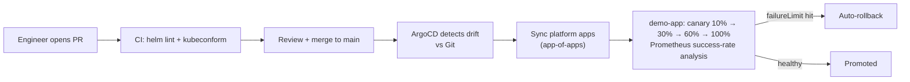

# eks-gitops-platform

[](https://github.com/shahbazkareem/eks-gitops-platform/actions/workflows/ci.yml)


A GitOps repository pattern for EKS: **ArgoCD app-of-apps**, restricted **AppProject RBAC**,
Helm charts for platform add-ons, and **canary deployments with automated rollback**.

Git is the only door to the cluster: nothing is kubectl-applied by hand. This is the
layout I use on production platforms serving banking and SaaS workloads.

## How a change flows



## Repository layout

```
├── bootstrap/
│   └── app-of-apps/root-app.yaml      # the ONE app installed by hand
├── projects/
│   └── platform-project.yaml          # AppProject: restricted repos, clusters, namespaces
├── applications/
│   ├── platform/                      # ingress-nginx, cert-manager, external-secrets
│   └── teams/demo-app.yaml            # team workload from charts/demo-app
├── charts/demo-app/                   # Helm chart with Argo Rollouts canary
├── docs/gitops-workflow.md            # the operating manual (promotion, break-glass)
└── .github/workflows/ci.yml           # lint + validate before Argo ever sees it
```

## Key patterns

### 1. App-of-apps
`bootstrap/app-of-apps/root-app.yaml` is the only manifest applied manually (once).
Everything else — platform add-ons and team apps — is managed declaratively from
`applications/`, and ArgoCD keeps the cluster reconciled to Git.

### 2. Least-privilege AppProject
`projects/platform-project.yaml` pins which Git repos, destination namespaces and
cluster resources platform apps may touch. A malicious or accidental change outside
the allow-list fails at sync, not at 3 AM in production.

### 3. Canary with automated analysis
`charts/demo-app` deploys an **Argo Rollouts** `Rollout` instead of a `Deployment`:
10% → 30% → 60% → 100%, with a Prometheus `AnalysisTemplate` checking request
success-rate between steps. `failureLimit: 1` means one bad measurement aborts and
rolls back — no human paged, no bad release propagated.

### 4. CI before CD
ArgoCD syncs *what is committed*, so correctness is enforced before commit:
GitHub Actions runs `helm lint` and `kubeconform` on every PR.

## Quick start

```bash
# 1. Install ArgoCD (once, per cluster)
helm repo add argo https://argoproj.github.io/argo-helm
helm install argocd argo/argo-cd -n argocd --create-namespace

# 2. Install the Rollouts controller (canary analysis needs it)
helm install argo-rollouts argo/argo-rollouts -n argo-rollouts --create-namespace

# 3. Bootstrap — apply the root app, everything else follows from Git
kubectl apply -f bootstrap/app-of-apps/root-app.yaml

# 4. Watch the fleet converge
argocd app list
kubectl argo rollouts get rollout demo-app -n demo --watch
```

## Production hardening checklist

- [ ] External OIDC (Dex / Okta) for ArgoCD SSO + RBAC groups
- [ ] Sealed Secrets / External Secrets Operator with AWS Secrets Manager backend
- [ ] Sync windows + progressive sync for prod namespace
- [ ] Image updater with digest pinning (no mutable tags)
- [ ] Notification integration (Slack webhook on sync-fail / rollback events)

## Related repositories

- [`terraform-aws-eks-blueprint`](https://github.com/shahbazkareem/terraform-aws-eks-blueprint) — the cluster this platform deploys onto
- [`k8s-observability-stack`](https://github.com/shahbazkareem/k8s-observability-stack) — the Prometheus endpoint the AnalysisTemplate queries

---

Shahbaz Kareem · [LinkedIn](https://linkedin.com/in/shahbaz-rahmat-kareem) · Available for global remote roles (UTC+5, EU/US overlap)
