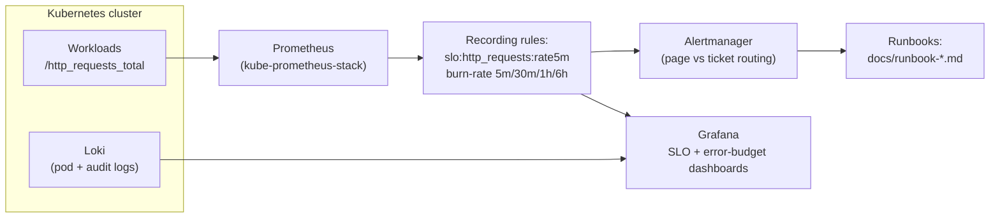

# k8s-observability-stack

[](https://github.com/shahbazkareem/k8s-observability-stack/actions/workflows/ci.yml)


Production-shaped observability for Kubernetes: **kube-prometheus-stack**, **Loki**,
**multi-window SLO burn-rate alerting**, and **runbooks wired into every alert**.

The design principle: an alert without a runbook is noise. Every alert in this repo
links to a doc that says what to check, in what order, and when to escalate.

## What "good" looks like here



## Contents

| Path | What it is |
|---|---|
| `values/kube-prometheus-stack.yaml` | Baseline values: retention, storage class, resource requests, ingress |
| `values/loki-stack.yaml` | Log aggregation without the ELK memory bill |
| `alerts/recording-rules.yaml` | SLI recording + multi-window error-budget burn rates |
| `alerts/alert-rules.yaml` | Page/ticket alerts derived from burn rates + golden signals |
| `docs/runbook-high-5xx.md` | The runbook the `High5xxErrorRate` alert links to |
| `docs/slo-worksheet.md` | How the SLO targets and error budgets were derived |

## Why multi-window burn-rate alerting

Raw `error_rate > 1%` alerts either page at 3 AM for noise or sleep through slow
outages. The industry-standard pattern (from the Google SRE workbook) pages on **error
budget consumption speed**, using paired windows:

| Pair | Catches | Route |
|---|---|---|
| 1 h + 5 m | fast burns, customer-visible now | **page** |
| 6 h + 30 m | sustained medium burns | **page** (lower priority) |
| 3 d + 6 h | slow leaks eating the quarterly budget | **ticket** |

Result I've seen on production platforms: **MTTR down ~45%** because pages became
rare and each one carried context.

## Quick start

```bash
helm repo add prometheus-community https://prometheus-community.github.io/helm-charts
helm repo add grafana https://grafana.github.io/helm-charts

helm install kube-prometheus-stack prometheus-community/kube-prometheus-stack \
  -n monitoring --create-namespace -f values/kube-prometheus-stack.yaml

helm install loki grafana/loki-stack \
  -n monitoring -f values/loki-stack.yaml

kubectl apply -f alerts/
```

## Dashboards

Grafana is provisioned with the community dashboards I use as a baseline:

- **15760** — Kubernetes views / global
- **15757** — Kubernetes views / pods
- **9969** — Prometheus overview error-budget style panel

Team-specific SLO dashboards are built from the recording rules in
`alerts/recording-rules.yaml` so the alert, the dashboard and the SLI can never disagree.

## Related repositories

- [`terraform-aws-eks-blueprint`](https://github.com/shahbazkareem/terraform-aws-eks-blueprint) — the cluster under this stack
- [`eks-gitops-platform`](https://github.com/shahbazkareem/eks-gitops-platform) — canary analysis consumes these Prometheus metrics

---

Shahbaz Kareem · [LinkedIn](https://linkedin.com/in/shahbaz-rahmat-kareem) · Available for global remote roles (UTC+5, EU/US overlap)
